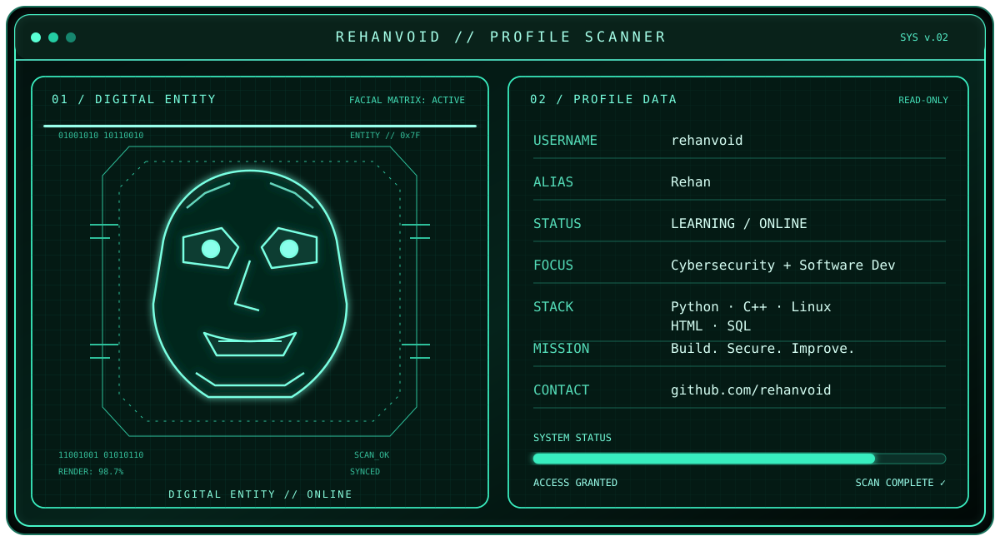

<div align="center">




</div>

<div align="center">


</div>

## `// TECH STACK`

<div align="center">


</div>

## `// ABOUT`

```text
USER      : Rehan (@rehanvoid)
INTERESTS : Cybersecurity, Software Development
MINDSET   : Build. Secure. Improve.
```

## `// CONNECT`

<div align="center">

<a href="https://github.com/rehanvoid"></a>
<a href="https://www.linkedin.com/in/rehan-shaikh-47002b445/"></a>

<br/><br/>


<br/>
<sub>ACCESS GRANTED // Thanks for visiting.</sub>

</div>
